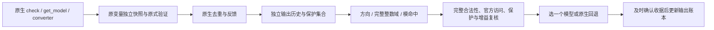

# 观察保留输出改进的实现说明

本轮入口是 `src/refinement/session_commit.inc`，由 `scripts/refinement/build.py` 嵌入隔离构建的 `refinement_include/session.hpp`。宿主 `LiaSampler::record_model` 的原生计数来自 `split->native.accepted_count`；停止条件和正式收据仍使用实际确认的输出数。`native_state.jsonl` 仅在受控检查开关启用时记录完整 RNG、m_ls 和原生版本；生产改进器没有写入这些对象的接口。

原生赋值从不被候选改写。首个正式输出恒等，原生重复不调用改进器；原生模型已存在于输出账本，仍可能是新的原生反馈。只在候选严格优于原生的 `(新增 covered, 新增观察)` 且完整保护通过时替换；相同得分回退原生。候选之间按方向 ID、绝对参数、参数排序。

`include/refinement/observations.hpp` 是任意精度纯值官方观察器，访问顺序遵从冻结脚本；未访问节点没有 zero/one 掩码。`history.hpp` 保护所有本次新观察，包括尚未双侧覆盖的第一侧。`affine_ir.hpp` 与 `directions.hpp` 只从顶层递归 AND 下明确的仿射等式生成整数核方向，并逐行验证 `A*d=0`。`line_domain.hpp` 保存完整区间并集，绝不以当前 OR 分支替代完整域；不支持或超限整方向回退。`modular_hits.hpp` 使用任意精度 floor_sum 与前缀计数二分，不枚举大模周期。

`refiner.hpp` 在每事件固定池/目标/候选额度内逐方向轮转。每个完整候选重新求原式、实际硬条件和官方观察，再核对保护掩码、输出去重和完整得分。未完成候选永不参与选择。L1 同一候选池的无保护选择仅作诊断，不提供给宿主输出。

`budget.hpp` 使用线程 CPU 与单调墙钟双账本，包含一次预处理、候选失败、验证、候选审计 JSON 编码和写入；宿主中实际信号中断通过取消回调传入每次合作检查。原生信用在查询及模型恢复边界计量，不含外部宿主日志或可选改进。不可中断操作的超支原样记录。必需交付成本单列且包含在完整会话中。

`scripts/refinement/independent.py` 与测试使用独立 Python 整数运算、原生语义值和冻结官方访问器，不调用候选实现来证明自身。`oracle_encoder.py` 为每节点构造精确 Reach；AND/OR 保留前序短路条件，共享 DAG 多路径取并。每个 protected 位必须同时有 Reach 和值条件；严格额外 covered 使用全部合法缺侧目标。Oracle 每案一个冷 solver、至多一次 check，仅诊断，不供给模型或排序。

运行和发布边界：先完成 Release/SAN、Python、关闭行为、实际替换隔离和事务重放；冻结 `manifests/refinement/implementation.json` 后才运行 `run_offline.py`。离线只执行一次固定的 43 模型、40 个 L1 位置和两套 L2 历史。`run_oracles.py` 固定 12 案，不挑成功位置。在线阶段必须依据离线 gate；失败时保留全部负结果而停止升级。
