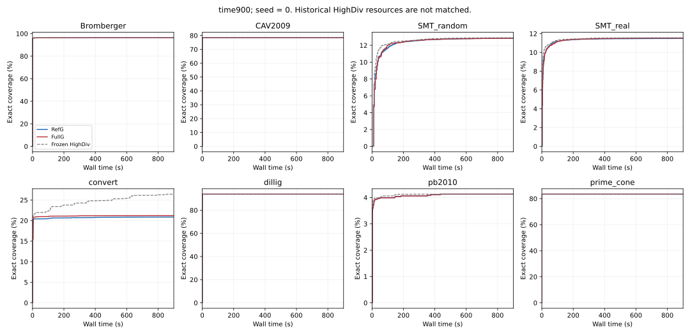
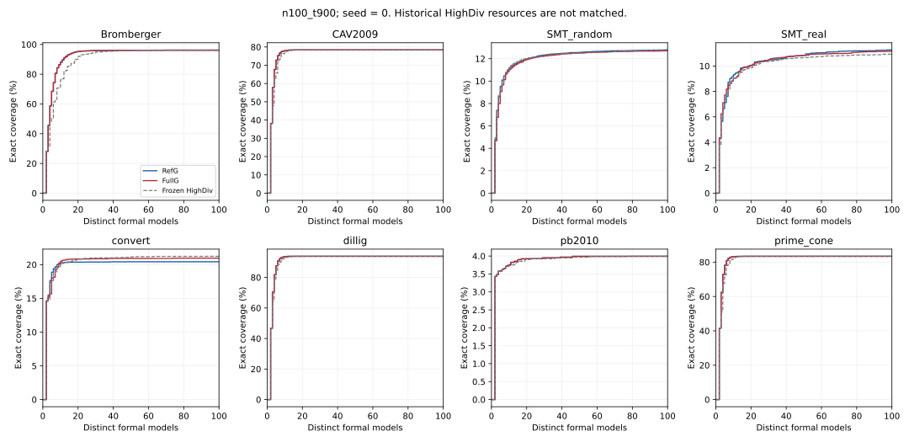

# Guided Sampler 第六轮：停滞守卫、预算回收与覆盖验证

本轮从 `ae85956068154207a442c0e2c8387c573dc32411` 建立独立分支 `round6-guarded-coverage-validation`。完成守卫实现、Release/ASan/UBSan、关闭回归、6 项 G1、24 项 G2及32项正式 F。G3 按预注册条件直接晋级 **FullG**，因此新增候选算法为零、候选短会话为零。没有重跑完整 HighDiv、增加 seed、扫阈值、开启 B 编码或修改 CCSS 的生产超时、初始化分布、move 和交换策略。

本轮正式结果未满足相对冻结完整 HighDiv 的整体改进条件，不能宣称已优于完整 HighDiv。

## 1. 守卫确实按全局 best 定义运行吗

是。核心在 [stagnation_guard.hpp](../include/round6/stagnation_guard.hpp)，原生接入见 [补丁](../patches/round6/round5_to_round6.patch) 和 [patch_sources.py](../scripts/round6/patch_sources.py)。每次 `ls_sampling()` 重置守卫；`update_best_solution()` 之后只观察原生 `_best_found_cost`，严格下降才刷新最后改善步。`initialize()` 里的严格全局改善同样刷新；内部 restart 本身不重置历史。连续 65536 原生步没有严格全局改善，且当前未满足数和全局 best 均非零时，返回普通 Unknown，原因是 `ccss_stagnation_yield`。零未满足不会被守卫截断，不提取停滞候选，不更新 m_ls。

新增搜索热路径仅有常数级整数记录和检查。map/RNG 序列化及文件输出在热路径外。日志实现为 [guard_trace.hpp](../include/round6/guard_trace.hpp) 和 [guard_bridge.inc](../src/round6/guard_bridge.inc)，宿主区分原生原因与 deadline/cancel。相位代码仍是第五轮冻结的 [soft_phase.inc](../src/round5/soft_phase.inc) 与 [覆盖评分](../include/round5/coverage_policy.hpp)；本轮没有重写覆盖机制。

Release、ASan/UBSan 各通过 29 项继承回归、14 项守卫检查及通用异常分类检查。关闭时原生决策、RNG、初始化、区间与模型逐字节符合第五轮保存证据。预冻结失败没有删除：一个算术测试预期错误；一个直接构造纯布尔配方暴露既有预处理泄漏，改用混合 LIA/布尔测试后通过。没有扩大泄漏抑制，也没有声称修复该既有纯布尔缺陷。详见 [G0记录](round6/g0_validation_notes.zh.md)。

## 2. 旧快解和旧慢状态如何

六项各执行一次。两个 M_ref 快解仍在第 219 步成功，best=0。两个 M_full 在第 65651 步交还，最后改善为第115步、best=25；两个空 map 在第65689步交还，最后改善为第153步、best=38。四项都恰好满足 65536 步差，不产生模型。构造状态、RNG、初始化区间和交还前保存进度一致，重放成功只证明约简 CCSS，不计正式模型或覆盖。

四项慢状态搜索 wall 为 1.628、1.635、1.796、1.745 秒，CPU 为 1.617、1.628、1.780、1.729 秒。旧对应运行均约52秒 cutoff。守卫也截断了更晚改善：旧 M_full 最终可降到23，空map可降到21，但仍没有成功。完整表见 [G1证据](round6/g1_evidence.zh.md)。

## 3. 回收了多少时间，是否增加后续检查

固定重放的搜索 wall 观察差约50.22–50.38秒；旧记录没有同边界的搜索 CPU 单独计时，不能把 wall 差冒充 CPU 差。真实 convert 的独立20模型 Full 会话为63.678秒，FullG为5.493秒，正式覆盖相同；进程CPU差约−58.235秒。120秒中 FullG 对 Full 多228次CDCL检查、228次CCSS检查；RefG 对 Ref 各多77次。

完整轨迹分叉后，不能将这些完整运行差值当作严格因果节省。新守卫整数记账与 map/RNG 日志没有独立隔离开销；它们包含在宿主检查和进程总成本中。每次原生搜索 CPU/wall、完整调用 wall、进程CPU/RSS、A显式成本及介入暴露成本均保留。

**发现成本关闭不完整。** 32项F中有 12 项累计指导成本计数超过45秒。关闭后的实际相位动作和后端元数据注册均为0，但继承的 `reference_collection_and_inputs_log_seconds` 与 `reference_source_log_seconds` 仍持续构造和记录，停用后计数合计又增加 570.834 秒。比如Bromberger FullG从关闭时约45秒增至103.292秒。原生守卫日志费用还包含在进程总成本中，不能将45秒描述为所有新增费用的硬上限。冻结实现没有在看到正式结果后修改；这是保留的成本控制负结果，见 [cost_tail.csv](../results/round6/formal_analysis/cost_tail.csv)。列出的运行期原始输出共 15.140 GiB，另有未在此清单计入的诊断文件，所有诊断开销都影响当前仪表化结果。

## 4. 多产生了多少模型和 covered

G2 convert：FullG 对 Full 净增224个合法不同模型、125个covered bit；RefG 对 Ref 净增73个模型、87 bit。FullG的5次交还后，以不重叠区间统计到448个后续正式模型、10058个新增covered；这是时间链中的产出，**不能**将448和10058称为守卫的净因果收益。所有10次 G2 交还（含独立数量会话）均保留逐调用事件。

F合计正式模型 103225 个，原始候选 206373 个，重复 103148 个，非法 0 个；记录守卫交还 23 次、原生异常/算术失败 2454 次。23次F交还全在convert，全部之后还有正式模型；具体事件时间链、下一次CDCL/合法模型/正覆盖延迟见 [yield_chains.csv](../results/round6/formal_analysis/yield_chains.csv)。下表是每会话中交还后不重叠区间产出，仍不是净因果增益；search wall仅为交还前耗时。

| 会话 | 交还次数 | 累计search wall/秒 | 后续正式模型 | 后续新增covered | 截止前无后续模型的交还 |
| --- | --- | --- | --- | --- | --- |
| 04_RefG_time900 | 9 | 12.318935825999997 | 1529 | 851 | 0 |
| 04_Chosen_time900 | 11 | 16.637264657 | 1758 | 10287 | 0 |
| 04_RefG_n100_t900 | 1 | 0.837435885 | 73 | 87 | 0 |
| 04_Chosen_n100_t900 | 2 | 4.120822848 | 97 | 9829 | 0 |

逐实例净差、来源和成本见 [正式完整表](round6/formal_tables.zh.md) 与 [performance.csv](../results/round6/formal_analysis/performance.csv)。最大进程预算尾部延迟为 2.835932 秒，所有正式收据仍严格早于预算截止。

## 5. Ref 和 Full 各自从守卫得到什么

下表每格为“正式模型 / covered”，保留所有24项结果。

| 实例 | 独立预算 | Ref | RefG | Full | FullG |
| --- | --- | --- | --- | --- | --- |
| convert | time120 | 384 / 37027 | 457 / 37114 | 227 / 37694 | 451 / 37819 |
| convert | n20_t120 | 20 / 36530 | 20 / 36530 | 20 / 37359 | 20 / 37359 |
| SMT_random | time120 | 39 / 13047 | 39 / 13047 | 46 / 12968 | 46 / 12968 |
| SMT_random | n20_t120 | 20 / 12538 | 20 / 12538 | 20 / 12418 | 20 / 12418 |
| SMT_real | time120 | 183 / 7516 | 183 / 7516 | 242 / 7477 | 240 / 7532 |
| SMT_real | n20_t120 | 20 / 6642 | 20 / 6642 | 20 / 6644 | 20 / 6644 |

convert提供了实际预算回收与后续产出的证据。random/real 的1170次原生失败全在搜索前，消息为 `Input string is not a valid number`；没有守卫触发，也没有CCSS模型。八个开关匹配组均有相同查询/map/RNG/seed的构造失败，且解析函数与第五轮相同。异常保留为 exception/Unknown，没有改名为 yield。具体非法数字 token 及历史第五轮的内部原因没有记录，仍是未知。

real 的 Full 与 FullG 在时间会话有55 bit差，但都未触发守卫；它们在第141与143查询触及既有45秒暴露保护。该差不能解释为守卫触发的因果收益。首次独立审计因这些异常要求复核而停止，复核证据与失败日志完整保留；没有重新采样。

## 6. 相同守卫下，覆盖信息还有额外价值吗

G2 FullG−RefG 的time120分别为 convert +705、random −79、real +16 bit；独立20模型为 +829、−120、+2 bit。三实例等权均值分别为 +0.113971 和 +0.116899 个百分点。convert和real两个端点均严格为正；random两个端点均为负，real幅度很小。该结果满足预注册晋级，但不是稳定性证明。

G2软偏好与实际相位改变统计如下。“同查询新观察”按每次会话内去重后再跨会话求和，不声称这些观察全由相位改变独立造成。reference不携带覆盖目标，其该列0不表示它没有覆盖产出。

| 来源 | 建议数 | 实际相位改变 | 同查询新观察（会话内去重） |
| --- | --- | --- | --- |
| coverage_support | 631 | 603 | 80 |
| avoid_direct_blocker | 666 | 584 | 56 |
| inherited_reference | 1364 | 268 | 0 |

正式关键实例的实际后端接收及相位改变如下；注册次数与实际改变分开，绑定计数会跨查询重复累计，不是唯一原子数。convert 的 FullG 实际support相位改变分别160次和91次；pb2010虽然收到元数据、也有原生决策，但exact/normalized绑定均为0，实际相位改变为0，仍未实现有效A干预。没有改动HighDiv路由制造触发。

| 实例 | 预算 | 后端接收元数据次数 | exact绑定累计 | normalized绑定累计 | support相位改变 | avoid相位改变 | reference相位改变 |
| --- | --- | --- | --- | --- | --- | --- | --- |
| convert_convert-jpg2gif-query-1459.smt2 | time900 | 160 | 160 | 240 | 160 | 0 | 27 |
| pb2010_normalized-j3048_8-sat.smt2 | time900 | 547 | 0 | 0 | 0 | 0 | 0 |
| convert_convert-jpg2gif-query-1459.smt2 | n100_t900 | 91 | 91 | 135 | 91 | 0 | 17 |
| pb2010_normalized-j3048_8-sat.smt2 | n100_t900 | 148 | 0 | 0 | 0 | 0 | 0 |

正式 F 以同一构建 RefG 为核心对照，其八实例结果如下；所有负差均保留。

| 比较 | 预算 | 八实例终点均值/百分点 | 正例 | 负例 | 严格100配对 | 严格100均值/百分点 |
| --- | --- | --- | --- | --- | --- | --- |
| RefG_vs_Chosen | time900 | +0.052127 | 4 | 0 | 不适用 | NA |
| RefG_vs_Chosen | n100_t900 | +0.043188 | 1 | 2 | 8 | +0.043188 |
| HighDiv_vs_Chosen | time900 | -0.666011 | 0 | 5 | 不适用 | NA |
| HighDiv_vs_Chosen | n100_t900 | -0.039309 | 1 | 4 | 8 | -0.039309 |

## 7. 局部收益是否被集合外损失抵消

沿用第五轮首模型分区：G1是共同映射的初始单侧bit，G2为其他单侧bit，G3为初始未访问bit；G0/G4也保留。下面是 FullG−RefG 的分区净差；分区之和等于官方全式差，逐bit独有收益和损失完整归档。

| 实例 | 预算/对齐 | G1 | G2 | G3 | G0 | G4 | 全式净差 |
| --- | --- | --- | --- | --- | --- | --- | --- |
| convert | time120 | +175 | +530 | +0 | +0 | +0 | +705 |
| convert | n20_t120 | +175 | +654 | +0 | +0 | +0 | +829 |
| SMT_random | time120 | +32 | -117 | +6 | +0 | +0 | -79 |
| SMT_random | n20_t120 | +52 | -162 | -10 | +0 | +0 | -120 |
| SMT_real | time120 | +0 | +22 | -6 | +0 | +0 | +16 |
| SMT_real | n20_t120 | -9 | +15 | -4 | +0 | +0 | +2 |

再用已完成的独立100模型做离线集合审计（没有新增采样或求解调用）：

| 实例/独立100模型 | G1 | G2 | G3 | G0 | G4 | 全式净差 |
| --- | --- | --- | --- | --- | --- | --- |
| convert | +181 | +772 | +0 | +0 | +0 | +953 |
| SMT_random | -36 | -43 | +0 | +0 | +0 | -79 |
| SMT_real | -51 | -12 | -10 | +0 | +0 | -73 |

convert的严格100模型增益没有被集合外损失抵消：G1净增181，G2净增772，总计953。random则G1和G2都退步；real的三个分区全部退步。因此正式结果不能概括为“只有集合外损失”，也不能只据G1目标命中判断整体效果。random与real的全式负结果没有被convert收益替代或隐藏；真实端点、共同前缀和指定目标独立审计结果分别保留于覆盖分区及目标表。

## 8. 最终选择哪个候选，为什么

直接选择 **FullG**。开发阶段验收分别为：

| 等级 | G2结束时判定 | 证据与边界 |
|---|---|---|
| G-PASS-LOCAL | 通过 | 两个219步快解保留、四个冻结慢状态安全交还；只属约简CCSS |
| G-PASS-TIME | 通过 | 真实convert触发守卫，独立20模型完整运行wall显著缩短 |
| G-PASS-USEFUL | 通过 | convert等时间中检查、合法不同模型和全式covered均增加 |
| G-PASS-COVERAGE | 按预注册开发判据通过 | 对RefG两预算均值正，convert与real两实例均正；random负，F严格100只有convert正 |

G2证据先在 `1a80700` 提交，随后G3决定在 `cb5dcc7` 提交，再冻结F计划。预注册说明明确已达总体晋级条件时不新增机制；不能因random单例损失再启动额外候选。候选A交替和候选B冷却均未实施，18项候选会话没有执行。

## 9. 是否改善等时间、等样本覆盖

G2达到预注册条件；F对RefG虽然两个均值均正，但严格100模型只有convert一例正收益，random与real反而分别减少79和73 bit。短实验中real的+2 bit没有延伸为100模型收益，正式结果没有保住至少两例的等样本改善，不能据均值宣称覆盖策略具有广泛优势。本轮16项独立 `n100_t900` 均完成100个正式模型，8个配对全部可比；预注册规则规定未完成者不进入严格100模型均值、胜负或平局。时间覆盖曲线、AUC、每模型增量、达到100模型的秒数和重复率都保留。

本轮没有新增候选算法，故“新增候选对FullG”不适用。FullG对Full的新增守卫消融来自G2同构建匹配控制，没有虚构或追加Full的900秒矩阵。

## 10. 是否晋级并执行900秒

是。预注册条件要求：时间均值正、独立严格20模型均值正、至少两个实例在两端点均正、至少两个完整20模型配对、正确性与真实有用交还成立。全部满足后才冻结并执行32项F，每项一次：8实例×RefG/FullG×time900/n100_t900。阈值65536保持不变，没有加seed、改参数或补跑。

固定16逻辑CPU槽，首次16项同步起跑，后继任务仅在预登记CPU槽空闲后按FIFO启动。计时期间没有构建、审计、压缩或上传。就绪、亲和性、派发、并发、wall/CPU/RSS及尾部延迟均在归档中。

## 11. 相对完整 HighDiv 如何

本轮正式结果未满足相对冻结完整 HighDiv 的整体改进条件，不能宣称已优于完整 HighDiv。

最大的已披露负差包括：convert_convert-jpg2gif-query-1459.smt2 / time900：-9322 bit，-5.199050 个百分点；convert_convert-jpg2gif-query-1459.smt2 / n100_t900：-491 bit，-0.273840 个百分点；20180326-Bromberger_v45_problem__003.smt2.slack.smt2 / n100_t900：-32 bit，-0.188869 个百分点；SMT_random_LIA_ex14600_2600_100.smt2 / n100_t900：-76 bit，-0.072631 个百分点。

convert提供了明确的后续瓶颈线索：FullG的900秒正式模型为11个CDCL与1750个CCSS；1763个CDCL原始候选中1752个重复（99.376%）。冻结HighDiv为2383个CDCL与2384个CCSS正式模型。FullG虽然能继续得到CCSS样本，但有效CDCL模型来源明显变少，不能只用总模型数解释最终覆盖差。原HighDiv在random/real也没有CCSS正式模型，因此不能把本轮这两例的差距直接归咎于新出现的CCSS解析失败。来源失衡、重复与等样本损失是直接证据；具体由软参考、暴露截止或其他轨迹差异贡献多少，仍需单因素研究。

完整 HighDiv沿用首轮冻结16项结果，没有重新运行。旧结果与本轮的资源占用、诊断日志成本并非完全配对；结论是单seed描述性对照。不能据G2三实例小幅正均值，替代八实例正式对完整HighDiv的结果。

## 12. 直接证据、推断和未知

直接证据包括全局best钩子、精确退出步、旧快解保留、冻结map/RNG与进度一致、真实宿主正常继续、正式模型合法且不同、截止接纳、官方与独立精确计分一致，以及完整的负差和Unknown。

事件链及匹配会话净差支持“回收时间可以转化为产出”，但轨迹分叉后的精确因果节约未知。相同seed不等于相同内部状态。最后全局改善墙钟没有测量，只记录精确步号；纯布尔直接构造缺陷未修复；解析失败的具体数字token未保存；新增记账/序列化成本没有独立隔离。独立审计是单独只读脚本与不同求值路径的交叉验证，不代表外部研究者或另一代理复核。

研究瓶颈已不能简单称为CCSS没有及时返回：convert的交还和新增模型都已发生，但有效CDCL新模型、来源多样性及等样本质量仍不足。不能用继续缩短守卫阈值替代这些问题。唯一具体的下一项工程改动建议是关闭指导后停止无用的软参考材料及全量参考诊断构造，同时保持原RNG消费、m_ls与map交换语义和必需守卫日志；它针对已证实的尾部成本，不预先宣称能修复等样本质量。本轮只提出建议，不实施或启动任何新因子。

## 复现与交付

入口为[执行指引](round6/execution_guide.zh.md)、[预注册判据](round6/decision_gates.zh.md)、[计分口径](round6/evaluation_contract.zh.md)、[实现冻结](../manifests/round6_implementation.json)、[正式计划](../manifests/round6_formal_plan.json)和[最终审计](../results/round6/audit_summary.json)。全部成功/失败测试、Unknown、取消、未完成、原始模型、收据、map/RNG身份及成本日志保存在 `archives/round6` 的分片归档；逐成员SHA和完整解压核验见manifest及verification文件。源码、补丁、报告和分析表随独立GitHub分支上传；未上传构建树、虚拟环境、第三方二进制或凭据。
